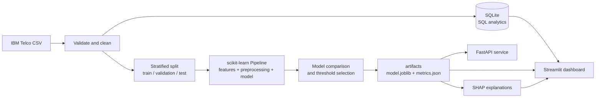
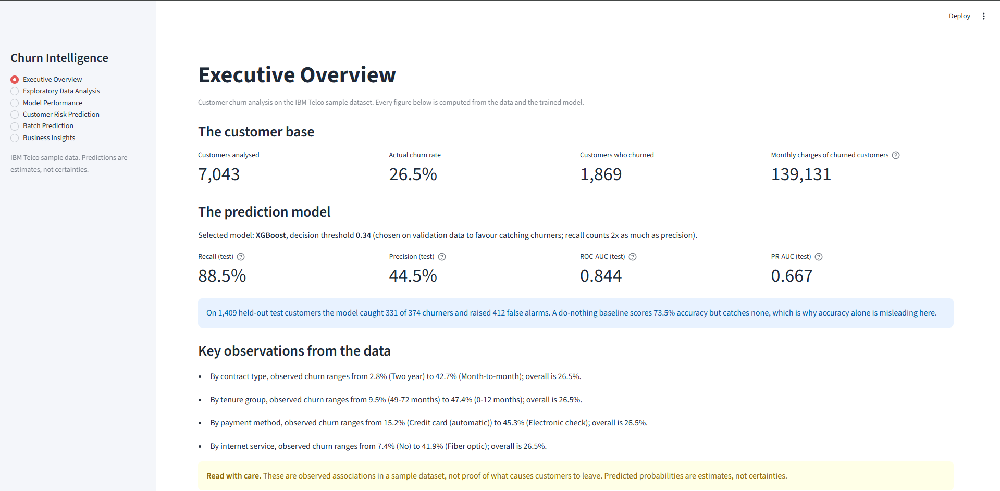
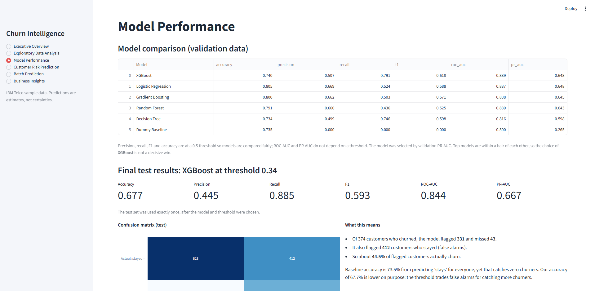
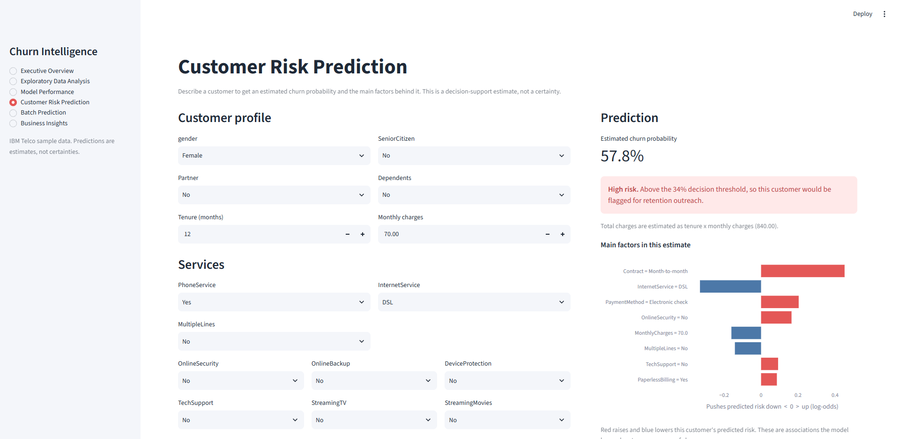
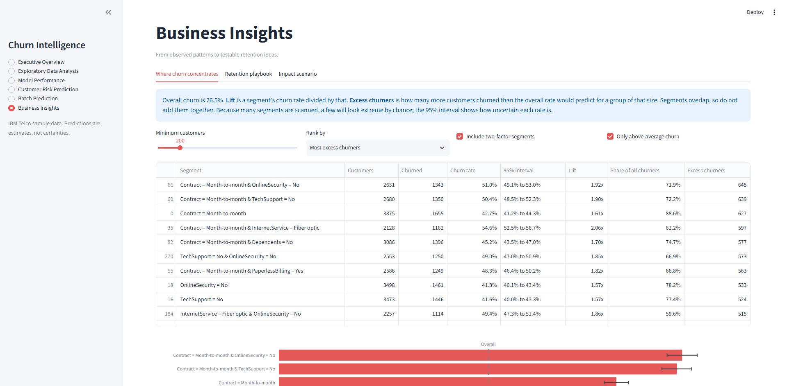

# Customer Churn Prediction and Business Intelligence Platform

An end-to-end data science project: it analyses telecom customer data, predicts who is likely to
leave, explains why, and turns the findings into testable retention ideas. It includes a SQL
analytics layer, a leakage-safe machine learning pipeline, model explainability, an interactive
Streamlit dashboard, and a FastAPI prediction service.

> **Data note:** the project uses the public IBM Telco sample dataset. It is sample data, not a real
> company's records, so no result here is a claim about a real business.

## Problem statement

Winning a new customer usually costs more than keeping an existing one. A telecom company wants to
know (1) which customers are likely to churn, (2) what is associated with churn, and (3) where a
retention effort is worth trying. The project answers these without over-claiming: predictions are
estimates, explanations describe associations rather than causes, and any financial estimate comes
from a calculator whose assumptions the user supplies.

## Key features

- **Data validation and SQL analytics:** automatic quality checks; churn analysed by SQL over SQLite.
- **Leakage-safe ML:** stratified train/validation/test split; preprocessing and tuning happen
  inside scikit-learn Pipelines; the test set is used once.
- **Honest evaluation:** a do-nothing baseline, five tuned models, threshold-free metrics (ROC-AUC,
  PR-AUC) and a documented, business-motivated decision threshold.
- **Explainability:** global SHAP and permutation importance, plus per-customer explanations.
- **Streamlit dashboard (6 pages):** overview, EDA, model performance, single-customer risk
  prediction, batch CSV prediction, and business insights with a what-if calculator.
- **FastAPI service:** `/health`, `/model-info`, `/predict`, `/predict-batch` with strict input
  validation and Swagger docs.
- **Tests and linting:** automated tests covering preprocessing, metrics, validation, API and
  dashboard pages; `ruff` configured.

## Architecture



Training, the API and the dashboard all load the same saved pipeline, so preprocessing is
identical everywhere. A test checks that batch predictions through the production path equal the
probabilities computed directly during evaluation.

## Dataset

- **Source:** the IBM Telco Customer Churn sample dataset, `Telco-Customer-Churn.csv`, downloaded
  from IBM's open-source repository
  [`IBM/telco-customer-churn-on-icp4d`](https://github.com/IBM/telco-customer-churn-on-icp4d).
  The same data is widely mirrored on Kaggle.
- **Licence:** IBM's repository is released under the Apache License 2.0. The repository presents
  the CSV as sample data and does not state a separate licence for the data file itself, so check
  the repository's `LICENSE` and terms before redistributing the data. This project does **not**
  commit the dataset; the download script fetches it.
- **Size:** 7,043 customers, 21 columns.
- **Target:** `Churn`. `Yes` means the customer left, `No` means they stayed. About 26.5% of
  customers churned, so the classes are moderately imbalanced.

| Column group | Columns |
|---|---|
| Identity | `customerID` (not used by the model) |
| Demographics | `gender`, `SeniorCitizen`, `Partner`, `Dependents` |
| Account | `tenure` (months), `Contract`, `PaperlessBilling`, `PaymentMethod` |
| Services | `PhoneService`, `MultipleLines`, `InternetService`, `OnlineSecurity`, `OnlineBackup`, `DeviceProtection`, `TechSupport`, `StreamingTV`, `StreamingMovies` |
| Charges | `MonthlyCharges`, `TotalCharges` |

11 customers have a blank `TotalCharges`; all of them have `tenure` 0 (brand new, not yet billed),
so the pipeline fills them with 0 and keeps a "was missing" flag.

## Installation (Windows, PowerShell)

Requires Python 3.11 or newer (developed on 3.13) and Git.

```powershell
git clone https://github.com/dronzerrrr/customer-churn-ai.git
cd customer-churn-ai
python -m venv .venv
.\.venv\Scripts\Activate.ps1
pip install -r requirements.txt
```

If PowerShell blocks activation, run once:
`Set-ExecutionPolicy -Scope CurrentUser -ExecutionPolicy RemoteSigned`.

## Train the model

One command runs the whole pipeline (download, validate, load SQLite, split, train, explain, test):

```powershell
.\run_pipeline.bat
```

Or step by step:

```powershell
python -m src.data.download_data
python -m src.data.validate
python -m src.data.database
python -m src.data.split
python -m src.models.train
python -m src.evaluation.explain
pytest -q
```

Training takes a few minutes on an ordinary CPU. No GPU, paid API or cloud service is needed.

## Run the dashboard and the API

```powershell
.\run_app.bat                      # dashboard at http://localhost:8501
.\run_api.bat                      # API docs at http://127.0.0.1:8000/docs
```

Equivalent manual commands (virtual environment activated, project root as working folder):

```powershell
streamlit run app/streamlit_app.py
uvicorn api.main:app --reload --port 8000
```

## API usage

```powershell
Invoke-RestMethod http://127.0.0.1:8000/health

$body = @'
{"gender":"Female","SeniorCitizen":0,"Partner":"No","Dependents":"No","tenure":5,
 "PhoneService":"Yes","MultipleLines":"No","InternetService":"Fiber optic",
 "OnlineSecurity":"No","OnlineBackup":"No","DeviceProtection":"No","TechSupport":"No",
 "StreamingTV":"Yes","StreamingMovies":"Yes","Contract":"Month-to-month",
 "PaperlessBilling":"Yes","PaymentMethod":"Electronic check","MonthlyCharges":95.5}
'@
Invoke-RestMethod -Uri "http://127.0.0.1:8000/predict?explain=true" -Method Post `
  -ContentType "application/json" -Body $body
```

The response contains `churn_probability`, `predicted_churn`, `risk_band`, the `threshold`, and
(with `explain=true`) the top reasons. Unknown categories, out-of-range values, impossible
combinations (for example "no internet" with "has Online Security") and unexpected fields return
HTTP 422 with a message naming the problem. `/predict-batch` scores valid rows and reports the
rejected ones. `TotalCharges` is optional and estimated as `tenure x MonthlyCharges` when absent.

## Example predictions

<!-- EXAMPLES:START -->
_Two illustrative customer profiles (made up for demonstration, not real people), scored by the saved model. Probabilities are estimates, not certainties._

| Profile | Churn probability | Risk band | Flagged? | Top factors |
|---|---|---|---|---|
| Higher-risk profile | 89.3% | High | yes | tenure = 5 (raises); Contract = Month-to-month (raises); InternetService = Fiber optic (raises) |
| Lower-risk profile | 1.9% | Low | no | Contract = Two year (lowers); tenure = 70 (lowers); InternetService = No (lowers) |
<!-- EXAMPLES:END -->

## Model evaluation results

<!-- RESULTS:START -->
_Generated by `python -m src.reporting.update_readme` from `artifacts/metrics.json` (trained 2026-10-18T18:45:05+00:00; Python 3.13.1, scikit-learn 1.9.1). Re-run training to reproduce._

**Data split** (stratified, seed 42): 4,225 train / 1,409 validation / 1,409 test. Churn rate in training data: 26.5%.

**Model comparison on the validation set** (precision, recall and F1 at a 0.5 threshold so models compare fairly; the model was selected by PR-AUC):

| Model | Accuracy | Precision | Recall | F1 | ROC-AUC | PR-AUC |
|---|---|---|---|---|---|---|
| XGBoost | 0.740 | 0.507 | 0.791 | 0.618 | 0.839 | 0.648 |
| Logistic Regression | 0.805 | 0.669 | 0.524 | 0.588 | 0.837 | 0.648 |
| Gradient Boosting | 0.800 | 0.662 | 0.503 | 0.571 | 0.838 | 0.645 |
| Random Forest | 0.791 | 0.660 | 0.436 | 0.525 | 0.839 | 0.643 |
| Decision Tree | 0.734 | 0.499 | 0.746 | 0.598 | 0.816 | 0.598 |
| Dummy Baseline | 0.735 | 0.000 | 0.000 | 0.000 | 0.500 | 0.265 |

**Final model: XGBoost**, decision threshold **0.34** (chosen on validation data by maximising F2, which weights recall more than precision). The test set was used once, after selection:

| Metric (test set) | Value |
|---|---|
| Accuracy | 0.677 |
| Precision | 0.445 |
| Recall | 0.885 |
| F1-score | 0.593 |
| ROC-AUC | 0.844 |
| PR-AUC | 0.667 |

Confusion matrix on 1,409 test customers: 331 churners caught, 43 missed, 412 false alarms, 623 correctly left alone.

**Why accuracy misleads:** a baseline that predicts "nobody churns" scores 73.5% accuracy while catching 0% of churners. The final model's accuracy (67.7%) is lower on purpose: the threshold trades false alarms for catching more churners.

**Most influential features** (validation data). The two methods can rank features differently because features are correlated:

| Feature | Mean absolute SHAP | Permutation PR-AUC drop |
|---|---|---|
| Contract | 0.692 | 0.090 |
| tenure | 0.516 | 0.129 |
| InternetService | 0.295 | 0.049 |
| MonthlyCharges | 0.240 | 0.021 |
| OnlineSecurity | 0.204 | 0.019 |
| PaymentMethod | 0.152 | 0.011 |
| TechSupport | 0.145 | 0.013 |
| MultipleLines | 0.099 | 0.002 |
<!-- RESULTS:END -->

## Screenshots

| Overview | Model performance |
|---|---|
|  |  |

| Customer risk prediction | Business insights |
|---|---|
|  |  |

## Project structure

```
app/            Streamlit dashboard (streamlit_app.py, common.py, views/)
api/            FastAPI service (main.py, schemas.py)
src/
  data/         download, load, validate, clean, SQLite, split, SQL analytics
  features/     feature engineering and the preprocessing pipeline
  models/       training, prediction, validation, risk bands, batch scoring
  evaluation/   metrics, plots, SHAP, segments, retention insights, impact calculator
  reporting/    README results generator
tests/          automated tests
notebooks/      EDA notebook
data/           raw and processed data (not committed)
artifacts/      trained model and metrics (not committed)
reports/        figures, tables, screenshots
```

## Methodology in brief

1. **Split first.** 60/20/20 stratified train/validation/test.
2. **Preprocess inside the pipeline.** Imputation, encoding and scaling are fitted on training data
   only (and on training folds during cross-validation), which prevents leakage.
3. **Tune on training data** with cross-validation; **compare models on validation data** using
   PR-AUC; choose the **decision threshold on validation data** by maximising F2.
4. **Evaluate once on the test set.**
5. **Explain** with SHAP and permutation importance, and compare the two.

## Limitations and ethical considerations

- **Sample data.** The dataset is a public IBM sample, not a real company's records. Results do
  not transfer to a real business without retraining and validation on that business's data.
- **Association, not causation.** The model and the segment analysis show who looks risky and where
  churn is higher. They do not show that changing a feature (a contract, a payment method) would
  change anyone's behaviour. Each retention idea in the dashboard ends with the experiment that
  would test it. The impact calculator uses placeholder assumptions and is not a forecast.
- **Probabilities are not calibrated.** Treat them as estimates for ranking and prioritising, not as
  literal chances. The risk bands are a presentation convention built on the decision threshold.
- **The threshold encodes an assumption.** F2 treats a missed churner as costlier than a false alarm.
  At the chosen threshold, roughly half of flagged customers are false alarms. Whether that is
  acceptable depends on the cost of an offer versus the value of a customer.
- **Models are close.** The top models score within a hair of each other on validation, so the
  selection is not a decisive win; a simpler model is nearly as good.
- **Fairness has not been audited.** The model uses demographic columns (`gender`, `SeniorCitizen`,
  `Partner`, `Dependents`). Using such attributes in real customer decisions can raise fairness and
  legal issues. A real deployment should audit performance across groups and consider excluding them.
- **No time dimension.** The data is a snapshot, so the model was not validated on future periods.
- **Not production-hardened.** The API has no authentication or rate limiting, and the saved model
  is tied to the library versions it was trained with.

## Future improvements

- Calibrate probabilities and report calibration curves.
- Audit fairness across demographic groups; evaluate removing sensitive features.
- Validate on a later time period; add drift monitoring.
- Run randomised retention experiments to measure real effects.
- Add authentication, logging and containerised deployment if the API goes beyond local use.

## Acknowledgements

Dataset: IBM Telco Customer Churn sample data. Built with pandas, scikit-learn, XGBoost, SHAP,
Streamlit, Plotly, FastAPI and Pydantic.

## License

Released under the MIT License (see `LICENSE`).

